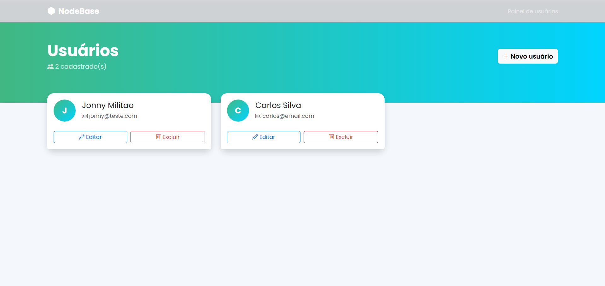
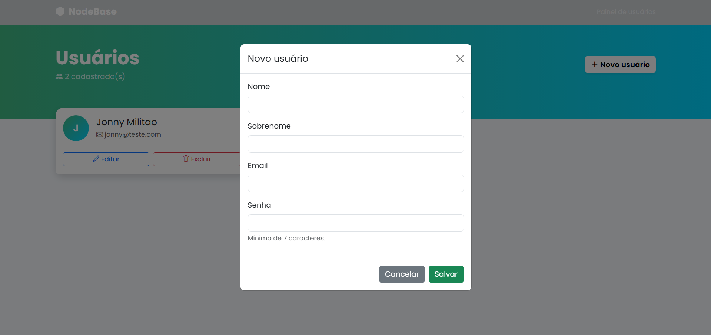
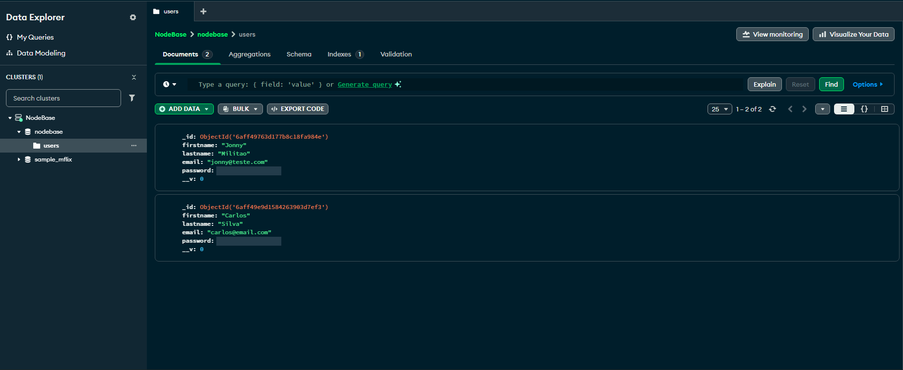

<div align="center">

# 🚀 NodeBase

**CRUD de usuários com Node.js, Express, MongoDB Atlas e EJS**

API REST + interface web em Bootstrap para cadastrar, editar e excluir usuários.

<p>
  
  
  
  
  
  
  
</p>



</div>

---

## 📑 Sumário

- [Sobre o projeto](#-sobre-o-projeto)
- [Funcionalidades](#-funcionalidades)
- [Screenshots](#-screenshots)
- [Tecnologias](#-tecnologias)
- [Estrutura do projeto](#-estrutura-do-projeto)
- [Como rodar](#-como-rodar)
- [Rotas da API](#-rotas-da-api)
- [Testando com o Postman](#-testando-com-o-postman)
- [Problemas comuns](#-problemas-comuns)
- [Próximos passos](#-próximos-passos)
- [Licença](#-licença)
- [Autor](#-autor)

---

## 📖 Sobre o projeto

O **NodeBase** foi criado durante um curso de Node.js para praticar, na prática, os pilares de uma aplicação web com back-end:

- rotas e métodos HTTP com **Express**
- modelagem e validação de dados com **Mongoose**
- persistência em nuvem com **MongoDB Atlas**
- renderização de páginas no servidor com **EJS** (usando _partials_)
- consumo da própria API pelo navegador com `fetch`

---

## ✨ Funcionalidades

- ✅ API REST completa: criar, listar, buscar, atualizar e excluir usuários
- ✅ Persistência no MongoDB Atlas com Mongoose
- ✅ Página `/views/users` renderizada com EJS, com cards de usuários
- ✅ Criar, editar e excluir pela interface, usando um modal do Bootstrap
- ✅ Validação no modelo (campos obrigatórios e senha com no mínimo 7 caracteres)
- ✅ O servidor só sobe depois que a conexão com o banco é estabelecida

---

## 📸 Screenshots

<table>
  <tr>
    <td align="center" width="50%">
      <b>Criar novo usuário</b><br /><br />
      
    </td>
    <td align="center" width="50%">
      <b>Editar usuário</b><br /><br />
      
    </td>
  </tr>
  <tr>
    <td align="center" colspan="2">
      <b>Dados salvos no MongoDB Atlas</b><br /><br />
      
    </td>
  </tr>
</table>

---

## 🛠️ Tecnologias

| Camada          | Tecnologia                                  |
| --------------- | ------------------------------------------- |
| Servidor        | Node.js, Express 5                          |
| Banco de dados  | MongoDB Atlas, Mongoose 9                   |
| Views           | EJS (com partials)                          |
| Interface       | Bootstrap 5, Bootstrap Icons, fonte Poppins |
| Configuração    | dotenv                                      |
| Desenvolvimento | nodemon                                     |

---

## 📂 Estrutura do projeto

```
NodeBase/
├── index.js                    # Ponto de entrada: carrega o .env, conecta no banco e sobe o servidor
├── models/
│   └── express.js              # App Express: middlewares, configuração do EJS e rotas
├── src/
│   ├── database/
│   │   └── connect.js          # Conexão com o MongoDB via Mongoose
│   ├── models/
│   │   └── users.models.js     # Schema e model de usuário
│   └── views/
│       ├── index.ejs           # Página de usuários (lista + modal de criar/editar)
│       └── partials/
│           ├── head.ejs        # <head> com Bootstrap e estilos
│           └── navbar.ejs      # Barra de navegação
├── docs/                       # Imagens usadas no README
├── .env                        # Variáveis de ambiente (não versionado)
├── LICENSE
└── package.json
```

---

## ⚙️ Como rodar

### Pré-requisitos

- [Node.js](https://nodejs.org/) 18 ou superior
- Uma conta no [MongoDB Atlas](https://www.mongodb.com/atlas) com um cluster criado
- O seu IP liberado em **Network Access** no Atlas (sem isso a conexão falha)

### Passo a passo

**1. Clone o repositório**

```bash
git clone https://github.com/JonnyMarcus/NodeBase.git
cd NodeBase
```

**2. Instale as dependências**

```bash
npm install
```

**3. Configure as variáveis de ambiente**

Crie um arquivo `.env` na raiz do projeto:

```env
PORT=8080
MONGODB_URI=mongodb+srv://<usuario>:<senha>@<cluster>.mongodb.net/nodebase?retryWrites=true&w=majority
```

> 💡 Se a senha tiver caracteres especiais (`@`, `#`, `/`), codifique-a na URL ou use uma senha só com letras e números.

**4. Inicie o servidor**

```bash
npm run dev
```

Você deve ver `Conectado ao MongoDB!` e depois `Servidor com Express rodando na porta 8080`.

**5. Acesse no navegador**

👉 <http://localhost:8080/views/users>

---

## 🔌 Rotas da API

|  Método  | Rota           | Descrição                               |
| :------: | -------------- | --------------------------------------- |
|  `GET`   | `/home`        | Verifica se o servidor está funcionando |
|  `GET`   | `/users`       | Lista todos os usuários                 |
|  `GET`   | `/users/:id`   | Busca um usuário pelo id                |
|  `POST`  | `/users`       | Cria um usuário                         |
| `PATCH`  | `/users/:id`   | Atualiza um usuário (campos parciais)   |
| `DELETE` | `/users/:id`   | Exclui um usuário                       |
|  `GET`   | `/views/users` | Página web com a lista de usuários      |

### Modelo de usuário

| Campo       | Tipo   | Regras                              |
| ----------- | ------ | ----------------------------------- |
| `firstname` | String | obrigatório                         |
| `lastname`  | String | obrigatório                         |
| `email`     | String | obrigatório                         |
| `password`  | String | obrigatório, mínimo de 7 caracteres |

<details>
<summary><b>📨 Exemplo: criar usuário (clique para abrir)</b></summary>

<br />

`POST http://localhost:8080/users`

```json
{
  "firstname": "Maria",
  "lastname": "Silva",
  "email": "maria@email.com",
  "password": "senha1234"
}
```

Resposta `201 Created`:

```json
{
  "_id": "6aff49763d177b8c18fa984e",
  "firstname": "Maria",
  "lastname": "Silva",
  "email": "maria@email.com",
  "password": "senha1234",
  "__v": 0
}
```

</details>

---

## 🧪 Testando com o Postman

1. Crie uma requisição **POST** para `http://localhost:8080/users`.
2. Na aba **Body**, escolha **raw** e o formato **JSON**.
3. Cole o JSON de exemplo e clique em **Send**.
4. Confirme com um **GET** em `http://localhost:8080/users`.

---

## 🩺 Problemas comuns

| Erro                                                       | Causa provável                            | Solução                                                                                        |
| ---------------------------------------------------------- | ----------------------------------------- | ---------------------------------------------------------------------------------------------- |
| `ECONNREFUSED` no Postman                                  | O servidor não está rodando               | Rode `npm run dev` e confira se aparece a mensagem da porta                                    |
| `tlsv1 alert internal error` / `MongoServerSelectionError` | O Atlas está recusando a conexão          | Libere o seu IP em **Network Access**, aguarde 1 minuto e tente de novo. Teste também sem VPN  |
| `Cannot find module`                                       | Caminho do `require` errado               | Confira o nome e a pasta do arquivo (os caminhos são relativos ao arquivo que faz o `require`) |
| `No default engine was specified`                          | Configuração do EJS com erro de digitação | Use `app.set("view engine", "ejs")` (`view` no singular)                                       |

---

## 📄 Licença

Este projeto está sob a licença [MIT](LICENSE). Você pode usar, copiar, modificar e distribuir o código, desde que mantenha o aviso de copyright e a licença.

---

## 👤 Autor

<div align="center">

**Jonny Marcus**

[](https://github.com/JonnyMarcus)

</div>
